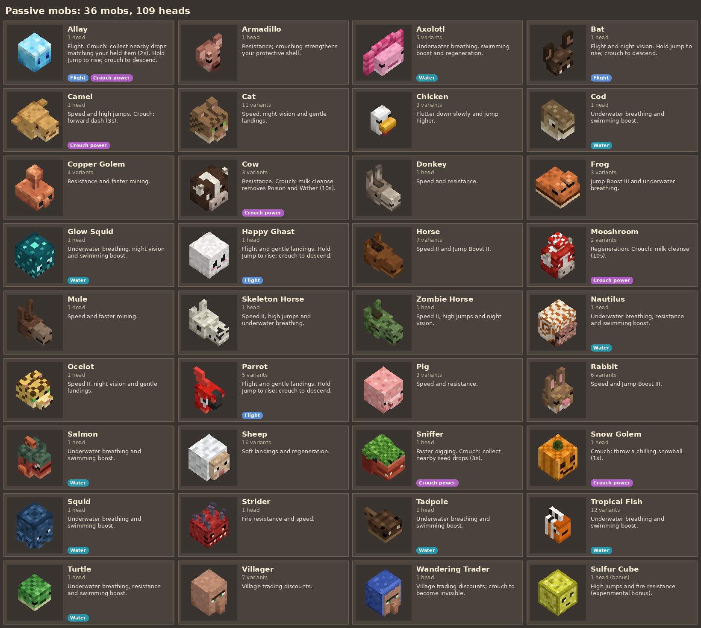
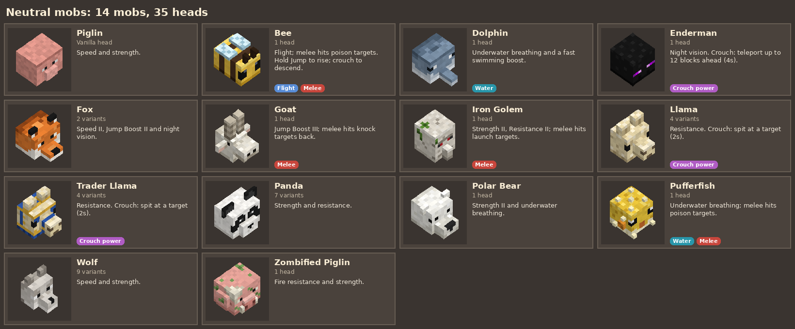
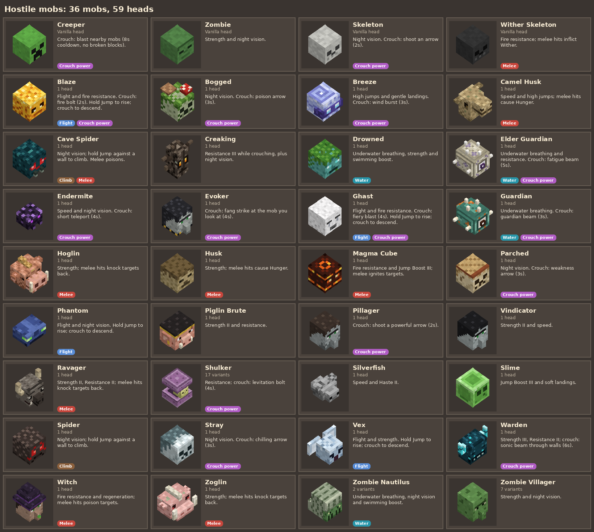
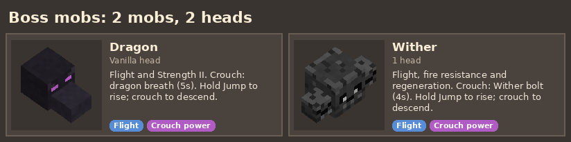

# Mob Trophies (Minecraft Bedrock add-on)

**Every mob drops its head.** Mob Trophies is a Minecraft Bedrock add-on that
makes every mob in the game drop a detailed, hand-drawn head when a player
kills it. Display your heads as trophies on the floor, walls and ceilings,
wear them as hats, and gain that mob's powers while you wear one: fly with a
Bat head, climb walls with a Spider head, teleport with an Enderman head or
breathe underwater with a Dolphin head. Collect one head from every mob to
become a **Trophy Master**, then hunt down every variant.


## Contents

- [Features](#features)
- [Installing](#installing)
- [How to play](#how-to-play)
- [Every head and its powers](#every-head-and-its-powers)
- [Commands and settings](#commands-cheats-on)
- [Editing the heads](#editing-the-heads)

## Features

- **205 heads**: 199 custom heads for 82 mobs plus the 6 vanilla heads
  (creeper, zombie, skeleton, wither skeleton, piglin, ender dragon), which drop
  as the real vanilla items.
- **One head per mob variant**: every cat breed, wolf coat, sheep colour, horse
  colour, llama, parrot, rabbit, axolotl, frog, fox, mooshroom and panda
  personality, the warm and cold cows, pigs and chickens, copper golem
  oxidation stages, villager and zombie villager biomes, shulker colours,
  tropical fish patterns and the coral zombie nautilus. The head that drops
  matches the mob you killed.
- **Detailed heads**: each head follows the shape of the mob's in-game head
  (snouts, beaks, ears, horns, tusks, fins, hats) with pixel art on every side.
- **Placement like vanilla skulls**: stand a head on a block (it turns to face
  you), mount it on the side of a block, or hang it underneath one.
- **Wear them**: put a head in your helmet slot to wear it. It is drawn scaled
  up over your own head.
- **Mob powers**: every head grants abilities while worn, from passive traits
  like speed and night vision to flight, wall climbing, teleporting and
  special attacks. All variants of a mob share its powers.
- **Collection tracking** with a **Trophy Ledger** book that shows your
  progress, and a world-wide announcement when you collect them all.
- **No experimental toggles**: works in Survival, Creative, single player,
  multiplayer and Realms.

## Installing

You need Minecraft Bedrock Edition **1.21.90 or newer** (iPhone, iPad,
Android, Windows, Xbox, PlayStation, Switch or Chromebook). Java Edition is
not supported.

### 1. Get the add-on file

Download [`dist/MobTrophies.mcaddon`](dist/MobTrophies.mcaddon). On the GitHub
page for the file, use the **download** button (the downward arrow at the top
right of the file view).

### 2. Import it into Minecraft

- **iPhone / iPad**: the file is saved to the **Files** app (usually in
  *Downloads*). Open it in Files, tap the **Share** button and choose
  **Minecraft**. If Minecraft is offered straight away when the download
  finishes, tap it.
- **Android**: open the downloaded file from your notifications or the Files
  app and choose to open it with **Minecraft**.
- **Windows**: double-click `MobTrophies.mcaddon`.
- **Consoles**: consoles cannot open `.mcaddon` files. Import the add-on on a
  phone, tablet or PC, add it to a world (step 3), then upload that world to a
  Realm or play it with friends on the console.

Minecraft opens and shows *Import started* then *Successfully imported* for
both the behavior pack and the resource pack.

### 3. Turn it on for a world

1. Create a new world, or tap the pencil icon next to an existing world.
2. Under **Add-Ons** (or **Behavior Packs** on older menus), find
   **Mob Trophies** in *Available* and tap **Activate**.
3. The matching resource pack is added for you. If Minecraft asks to activate
   it as well, say yes.
4. Play the world. Other players who join download the packs automatically.

Back up existing worlds before adding any add-on.

### Updating

Import the new `.mcaddon` the same way. Then open the world's settings and
check that both **Mob Trophies** packs show version **1.2.1**. If an old
version is still active, deactivate it and activate the new one. Your
collection progress is kept.

## How to play

### Getting heads

Kill any mob and it drops its head. Melee, arrows, tridents and other
projectiles all count, and baby mobs drop heads too. Variant mobs drop the
matching variant head, so a tuxedo cat drops a Tuxedo Cat Head and a lime
sheep drops a Lime Sheep Head.

| Mob | How to get the head |
| --- | --- |
| Creaking | Break its active Creaking Heart while the creaking is nearby. |
| Ender Dragon, Wither | Drops if a player is nearby when it dies, even if the final blow was an explosion. |
| Villager, Zombie Villager | Both the old and new villager entity types count. |
| Sulfur Cube | Bonus head. It is still experimental, so it does not count towards the 87. |

### Displaying heads

Heads place like vanilla skulls:

- **On top of a block**: the head turns to face you.
- **On the side of a block**: it is mounted on the wall like a hunting trophy.
- **Under a block**: it hangs from the ceiling.

### Wearing heads and using their powers

Put a head in your **helmet slot** to wear it. It is drawn scaled up over your
own head, and you gain the mob's powers straight away. Carrying a head or
placing it as a trophy does not grant powers. A message tells you the ability
when you equip it.


| What you want to do | How |
| --- | --- |
| Passive traits (speed, strength, night vision, fire resistance, jump boost, underwater breathing) | Nothing to do: they are always on while the head is worn. |
| Special power (attack, teleport, dash, cleanse) | **Press crouch** once (it also works underwater). If crouch stays on, as it does on touch screens, tap it again to stand up first: standing up never fires the power. Each mob has a cooldown, shared by all its variants, and a message tells you when a long cooldown is over. |
| Fly (Bat, Parrot, Allay, Bee, Happy Ghast, Phantom, Vex, Blaze, Ghast, Wither, Dragon) | Hold **Jump** to rise, steer with the movement controls, release Jump to glide down, crouch to descend. Works in Survival. |
| Climb (Spider, Cave Spider) | Face a wall and hold **Jump**. |
| Swim faster (aquatic heads) | Use the normal swimming controls. |
| Melee traits (poison, Wither, fire, knockback, hunger) | Hit a mob while wearing the head. |

Good to know:

- Head-granted effects are removed when you take off or swap the head. Potion
  and beacon effects you already had are kept.
- Cooldowns cannot be skipped by swapping variants or respawning.
- Creeper blasts hurt nearby mobs without hurting you or breaking blocks.
  Fire bolts and other magic attacks are aimed strikes that do not destroy
  terrain.
- Aimed powers (Warden sonic boom, fire bolts, beams, spit, arrows and
  snowballs) have aim assist: they lock on to the mob nearest the middle of
  the screen, so on an iPad or phone you only need to face the mob roughly.
  If nothing is in front of you they hit the last mob you attacked. Pets and
  other players are only hit if you aim right at them.
- A missed beam is still drawn so you can see where it went, and a miss does
  not start the cooldown.
- Teleporting needs an empty spot with ground underneath and stops at walls.
- These are playable takes on each mob's traits, not a full transformation.
  Mobs without a useful player power give a related trait such as resistance,
  haste or regeneration.

### Collecting them all

- A head counts as collected the first time it lands in your inventory or
  helmet slot. A mob counts towards the collection once you have any of its
  variants, and every variant is tracked too. Progress is saved per player in
  the world.
- New players get a **Trophy Ledger** book. Use it to see your progress, split
  into Passive, Neutral, Hostile and Boss mobs, with a page per mob listing its
  variants. The category pages also explain every mob's powers. Lost it? Craft a new one from a **book + bone**.
- Collect all **87 required mob heads** to become a **Trophy Master**: a title
  appears on screen and the achievement is announced to everyone in the world.

## Every head and its powers

Each card shows the mob's head, how many variant heads it has, and what
wearing it does. Durations in brackets are cooldowns, and Roman numerals are
effect levels. Coloured tags mark heads that let you **fly**, **climb**,
**breathe underwater**, use a **crouch power**, or add a **melee** effect to
your hits. Every variant of every head is shown in the picture at the top of
this page. The same list is available as text in
[docs/head-abilities.md](docs/head-abilities.md).

### Passive mobs



### Neutral mobs



### Hostile mobs



### Bosses



## Commands (cheats on)

- `/scriptevent mh:ledger` opens the Trophy Ledger.
- `/scriptevent mh:reset` clears your collection (handy for testing).

## Settings

Near the top of `src/scripts/main.js`:

- `DROP_CHANCE`: chance a head drops (default `1.0`, so always).
- `BOSS_PLAYER_RADIUS`, `CREAKING_RADIUS`: how close a player must be.

## Editing the heads

The packs are generated from Python, so tweaking a head means editing data, not
JSON.

- `tools/mobs.py` holds the data model and explains how art maps onto each
  face. Variants are listed with `V(...)`, including how the game tells them
  apart (the mob's `variant`, `mark_variant` or `color` component, or an entity
  property such as `minecraft:climate_variant`).
- `tools/art/*.py` hold the heads themselves: size, palette, pixel art for the
  front, sides, top and back, and extra cubes (snouts, ears, horns, hats).
- `tools/build.py` turns that into blocks, wearable items, block and worn
  geometry, attachables, textures, the language file, `scripts/heads.js` and the
  `.mcaddon`.
- `tools/preview.py` renders `docs/heads_preview.png`,
  `docs/worn_preview.png` and the `docs/abilities_*.png` cards from the
  generated geometry and textures, so you can check your art without launching
  the game. The card text comes from `src/scripts/abilities.js`.

```sh
pip install pillow
python3 tools/build.py
python3 tools/preview.py
python3 tools/preview.py --only cat --back --zoom 2 --out cats.png   # one mob, front and back
python3 tools/preview.py --only cat --worn --out cats_worn.png       # worn by a player
python3 tools/preview.py --abilities                                 # only the ability cards
```

The build output all goes into `dist/`, which is wiped and recreated on every
build. The game script is hand written in `src/scripts/main.js` and copied into
the behavior pack, so edit it there, never in `dist/`.

If a future update adds a new mob, add an entry to one of the `tools/art/`
files and rebuild. The ledger and collection total update automatically.

## Project layout

```
src/scripts/main.js        game logic (hand written)
src/scripts/abilities.js   worn-head powers and ability descriptions
tests/abilities.test.cjs   ability lifecycle and combat regression tests
tools/                     generator and preview renderer
  art/                     head art, one file per group of mobs
dist/                      build output (generated, do not edit)
  MobTrophies_BP/          behavior pack (blocks, head items, ledger, recipe, scripts)
  MobTrophies_RP/          resource pack (geometry, attachables, textures, names)
  MobTrophies.mcaddon      both packs zipped, ready to install
```

## Validation

After rebuilding, run the behaviour tests:

```sh
node --test tests/abilities.test.cjs
```

To check the new power script against the exact stable Bedrock 2.0.0 API:

```sh
npm install
npm run check
```

The tests use a mocked Bedrock API to check all 205 heads, equipping and
removal, potion preservation, variants, cooldowns, multiplayer isolation,
teleport destinations, melee traits and projectile ownership. They do not
replace testing in Minecraft. For a manual smoke test, equip a Spider, Bat,
Enderman, Creeper, Bogged and aquatic head; try their controls, switch heads
and remove them, then repeat with a second player.

