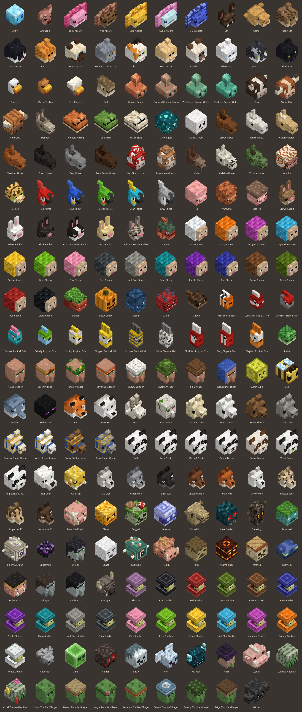
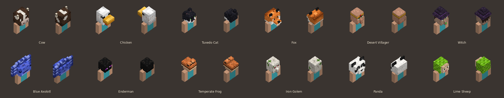

# Mob Trophies (Minecraft Bedrock add-on)

Every mob drops its head when a player kills it. Heads can be placed on top of a
block, mounted on a wall, hung from a ceiling like a trophy, or worn as a hat.
Collect one head from every mob in the game to become a **Trophy Master**, then
hunt down every variant.





## Features

- **205 heads**: 199 custom heads for 82 mobs plus the 6 vanilla heads
  (creeper, zombie, skeleton, wither skeleton, piglin, ender dragon), which drop
  as the real vanilla items.
- **One head per mob variant**: every cat breed, wolf coat, sheep colour, horse
  colour, llama, parrot, rabbit, axolotl, frog, fox, mooshroom and panda
  personality, the warm and cold cows, pigs and chickens, copper golem
  oxidation stages, villager and zombie villager biomes, shulker colours,
  tropical fish patterns and the coral zombie nautilus. The head that drops
  matches the mob you killed.
- **Detailed heads**: each head follows the shape of the mob's in-game head
  (snouts, beaks, ears, horns, tusks, fins, hats) with pixel art on every side.
- **Placement like vanilla skulls**: stand a head on a block (it turns to face
  you), mount it on the side of a block, or hang it underneath one.
- **Wear them**: put a head in your helmet slot to wear it. It is drawn scaled
  up over your own head.
- **Collection tracking**: a head counts as collected the first time it lands in
  your inventory or helmet slot. A mob counts towards the collection once you
  have any of its variants; every variant is tracked too. Progress is saved per
  player in the world.
- **Trophy Ledger**: new players get a Trophy Ledger book. Use it to see your
  progress, split into Passive, Neutral, Hostile and Boss mobs, with a page per
  mob listing its variants. Lost it? Craft a new one from a **book + bone**.
- **Completion reward**: collecting all 87 required heads shows a title and
  announces it to everyone in the world.

### Special cases

| Mob | How to get the head |
| --- | --- |
| Creaking | Break its active Creaking Heart while the creaking is nearby. |
| Ender Dragon, Wither | Drops if a player is nearby when it dies, even if the final blow was an explosion. |
| Villager, Zombie Villager | Both the old and new villager entity types count. |
| Sulfur Cube | Bonus head. It is still experimental, so it does not count towards the 87. |

All other mobs must be killed by a player (melee, arrows, tridents and other
projectiles all count). Baby mobs drop heads too.

## Installing

**iPhone / iPad / Windows / Android:** download
[`dist/MobTrophies.mcaddon`](dist/MobTrophies.mcaddon) and open it. Minecraft
imports both packs. Then, when creating or editing a world, activate
**Mob Trophies** under *Behavior Packs* (the resource pack is added for you).

Requires Minecraft Bedrock **1.21.90 or newer**. No experimental toggles are
needed.

## Commands (cheats on)

- `/scriptevent mh:ledger` opens the Trophy Ledger.
- `/scriptevent mh:reset` clears your collection (handy for testing).

## Settings

Near the top of `src/scripts/main.js`:

- `DROP_CHANCE`: chance a head drops (default `1.0`, so always).
- `BOSS_PLAYER_RADIUS`, `CREAKING_RADIUS`: how close a player must be.

## Editing the heads

The packs are generated from Python, so tweaking a head means editing data, not
JSON.

- `tools/mobs.py` holds the data model and explains how art maps onto each
  face. Variants are listed with `V(...)`, including how the game tells them
  apart (the mob's `variant`, `mark_variant` or `color` component, or an entity
  property such as `minecraft:climate_variant`).
- `tools/art/*.py` hold the heads themselves: size, palette, pixel art for the
  front, sides, top and back, and extra cubes (snouts, ears, horns, hats).
- `tools/build.py` turns that into blocks, wearable items, block and worn
  geometry, attachables, textures, the language file, `scripts/heads.js` and the
  `.mcaddon`.
- `tools/preview.py` renders `docs/heads_preview.png` and
  `docs/worn_preview.png` from the generated geometry and textures, so you can
  check your art without launching the game.

```sh
pip install pillow
python3 tools/build.py
python3 tools/preview.py
python3 tools/preview.py --only cat --back --zoom 2 --out cats.png   # one mob, front and back
python3 tools/preview.py --only cat --worn --out cats_worn.png       # worn by a player
```

The build output all goes into `dist/`, which is wiped and recreated on every
build. The game script is hand written in `src/scripts/main.js` and copied into
the behavior pack, so edit it there, never in `dist/`.

If a future update adds a new mob, add an entry to one of the `tools/art/`
files and rebuild. The ledger and collection total update automatically.

## Project layout

```
src/scripts/main.js        game logic (hand written)
tools/                     generator and preview renderer
  art/                     head art, one file per group of mobs
dist/                      build output (generated, do not edit)
  MobTrophies_BP/          behavior pack (blocks, head items, ledger, recipe, scripts)
  MobTrophies_RP/          resource pack (geometry, attachables, textures, names)
  MobTrophies.mcaddon      both packs zipped, ready to install
```
